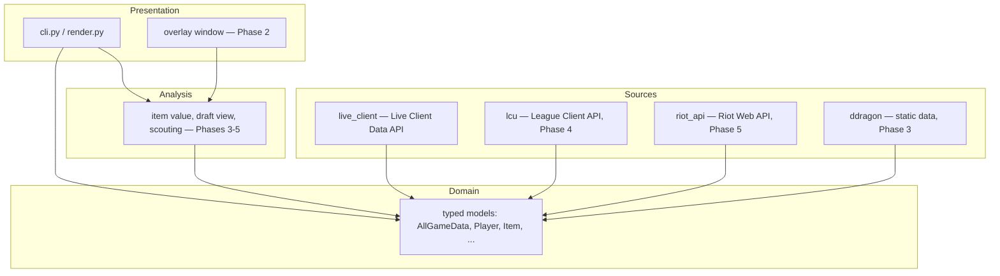

# Architecture

TouchstAune is organised in four layers. Dependencies only point **downwards**. The UI never
talks to an API directly, and the analysis code never knows where its data came from.



## Design decisions

| Decision | Why |
|---|---|
| **pydantic v2 models, `extra="ignore"`** | Riot adds fields without notice. We validate only the fields we use, so new fields never break parsing. Models are frozen (immutable snapshots). |
| **httpx with an injectable transport** | Tests replace the network with `httpx.MockTransport`. No game is needed to run the test suite. |
| **"No game" returns `None`; "bad payload" raises** | When the API is unreachable, the game simply isn't running, which is normal. A malformed payload is a bug and must surface. |
| **`GameRecorder.step()` is a single, sleep-free poll** | The polling loop lives in the CLI, so the state machine (waiting → in game → ended) can be tested deterministically. |
| **Raw JSON is recorded, not parsed models** | Snapshots are faithful fixtures. Model changes can be replayed against real data. |
| **Pure rendering functions** | `render.format_scoreboard()` returns a string. It is easy to test, and the overlay can reuse the same view logic. |

## Data flow — Phase 1

```text
game client ──HTTPS──▶ LiveClient.fetch_raw() ──dict──▶ GameRecorder.step()
                                                         ├─▶ snapshots/<game>/tNNNNN.json
                                                         └─▶ AllGameData ──▶ format_scoreboard() ──▶ stdout
```
